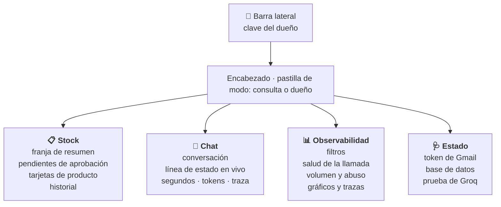
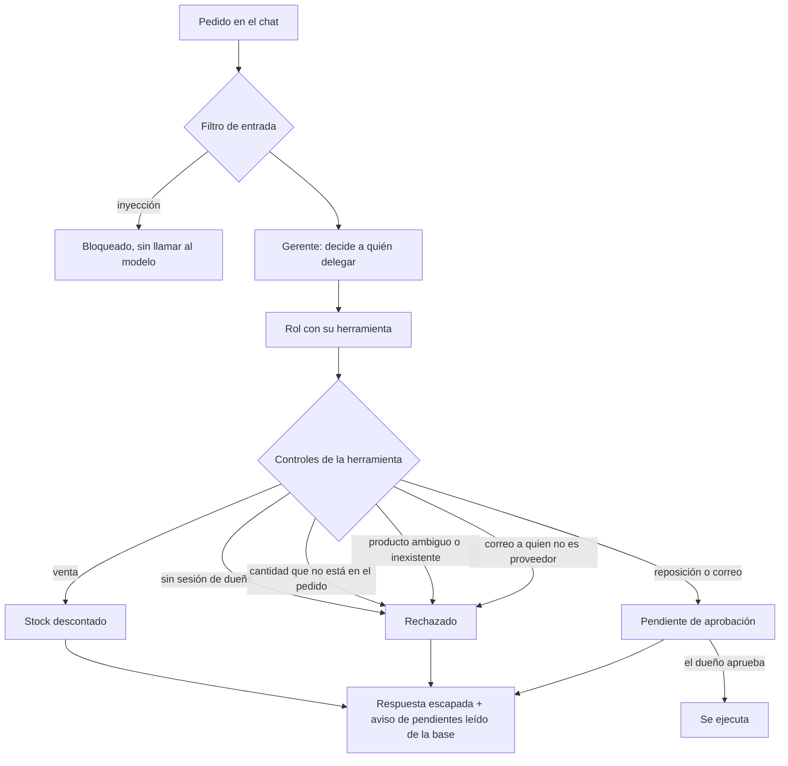

# Diseño

Bocetos de la interfaz y del recorrido de un pedido.

## Pantallas

| Pestaña | Usa IA | Para qué |
|---|---|---|
| Stock | no | ver el inventario y aprobar lo que propusieron los agentes |
| Chat | sí | pedir ventas, consultas y reposiciones en lenguaje natural |
| Observabilidad | no | métricas y trazas guardadas |
| Estado | solo el botón de Groq | revisar que todo esté conectado |

## Recorrido de un pedido y sus controles

Los rechazos los decide el código de la herramienta, no el modelo.
