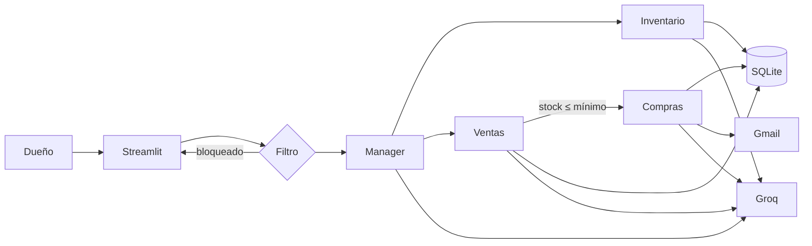
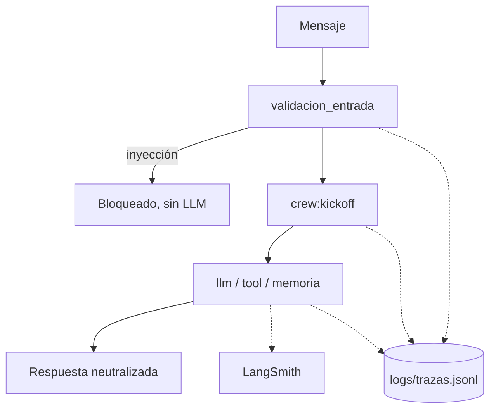

# Gestión de Tienda IA

Agentes CrewAI sobre el stock de una tienda (productos, ventas, proveedores),
con observabilidad y controles de seguridad. ISY0101, Duoc UC.

## Arquitectura



| Rol | Puede |
|---|---|
| Inventario | leer stock, bajo mínimo, historial |
| Ventas | registrar ventas |
| Compras | proponer reposiciones y correos a proveedores |
| Manager | solo delegar |

La orden al proveedor la dispara Python (`stock ≤ mínimo`), no el LLM.
Reponer stock y enviar correos **quedan pendientes** hasta que el dueño los
aprueba en la pestaña Stock (`pendientes.py`).

## Una petición, paso a paso



Cada etapa queda como evento en la traza: duración, tokens, modelo y estado.

## Instalar

```bash
uv sync
cp .env.example .env                # GROQ_API_KEY; LangSmith es opcional
uv run python db.py                 # base de demo
uv run python autenticar_gmail.py   # una vez, login de Gmail en el navegador
```

`.env`, `credentials.json`, `gmail_token.json`, `tienda.db` y `logs/` no se versionan.

## Correr

```bash
uv run streamlit run app.py --server.fileWatcherType none   # app
uv run pytest -q                                              # tests, sin LLM ni red
uv run python bateria.py --listar                             # casos de medición
uv run python bateria.py --todos --repeticiones 3             # gasta cuota de Groq
uv run python observabilidad.py [trace_id]                    # ver trazas y métricas
```

`bateria.py` reinicia la base antes de cada caso, verifica la respuesta contra
SQLite y reemplaza el envío de Gmail por un registro local.

## Observabilidad

| Métrica | De dónde sale |
|---|---|
| Precisión | respuesta comparada contra la base (`bateria.py`) |
| Consistencia | mismo caso repetido N veces |
| Latencia (p50, p95) | duración por traza y por etapa |
| Tokens y llamadas | cada llamada a Groq, medida en `LLMConFallback` |
| Errores | traza caída vs. errores internos (rate limit, memoria) |
| Bloqueos | inyecciones cortadas antes del crew |

`observabilidad.py` sigue el formato de `RA3/IL3.1` y `RA3/IL3.2` del curso,
pero con datos reales del bus de eventos de CrewAI. Los tokens no salen de
`crew.usage_metrics`, que cuenta el LLM compartido una vez por agente.

LangSmith (opcional): `LANGSMITH_TRACING=true` y `LANGSMITH_API_KEY` en `.env`.

## Seguridad

| Riesgo | Control |
|---|---|
| Inyección directa | filtro normalizado (tildes, invisibles, homoglifos, base64, rot13) |
| Inyección indirecta | un nombre de producto con instrucciones no llega al prompt |
| Argumentos del LLM | cantidades positivas, SQL parametrizado, `LIKE` escapado |
| Correo a terceros | solo a proveedores registrados en la base |
| Acciones irreversibles | reposición y correo esperan aprobación humana |
| Producto equivocado o repetido | la tool resuelve el nombre sin adivinar y no repite una operación en el mismo mensaje |
| Consumo sin tope | máximo de tokens y de rechazos por límite en cada mensaje |
| Salida en pantalla | HTML escapado, sin imágenes ni enlaces markdown |
| Datos personales en logs | correos, RUT y teléfonos redactados |

El filtro es la primera capa y se puede evadir (hex, otro idioma, paráfrasis);
los tests lo dejan escrito. Lo que contiene el daño es el mínimo privilegio y
la validación en las tools. Detalle: `SEGURIDAD-OWASP.md`.

## Decisiones

- **CrewAI y no LangGraph:** tres roles con prompts incompatibles (vender ≠
  negociar con proveedores), el caso que el curso reserva para un framework de roles.
- **Lo irreversible no depende del LLM:** la orden de compra se dispara por
  regla y va directo a Compras, sin pasar por el manager.
- **Memoria nativa de CrewAI** con embeddings locales (Groq no ofrece
  embeddings); el historial de movimientos vive en SQLite.
- **Fallback de modelos:** si Groq devuelve rate limit, se rota entre
  `gpt-oss-120b`, `qwen3.8-27b` y `gpt-oss-20b` (cupos separados).

## Archivos

| Archivo | Qué es |
|---|---|
| `agentes.py` | roles, tools, manager, fallback de modelos |
| `stock.py`, `db.py` | dominio en Python puro, sin LLM |
| `pendientes.py` | acciones que esperan aprobación del dueño |
| `guardrails.py` | filtro de entrada, PII, salida segura |
| `observabilidad.py` | trazas, métricas, analizador |
| `bateria.py` | casos de medición con verificación |
| `app.py` | interfaz Streamlit |
| `test_*.py` | tests sin red |
| `ESQUEMA-PLANIFICACION.md` | orden de decisión del sistema |
| `SEGURIDAD-OWASP.md` | mapeo OWASP 2026 |

## Referencias

- CrewAI — <https://docs.crewai.com/>
- Groq — <https://console.groq.com/docs/models>
- OWASP Top 10:2025, A05 Injection — <https://owasp.org/Top10/2025/A05_2025-Injection/>
- OWASP Top 10 for LLM Applications 2026 — <https://genai.owasp.org/>
- Gmail API — <https://developers.google.com/gmail/api/guides>
