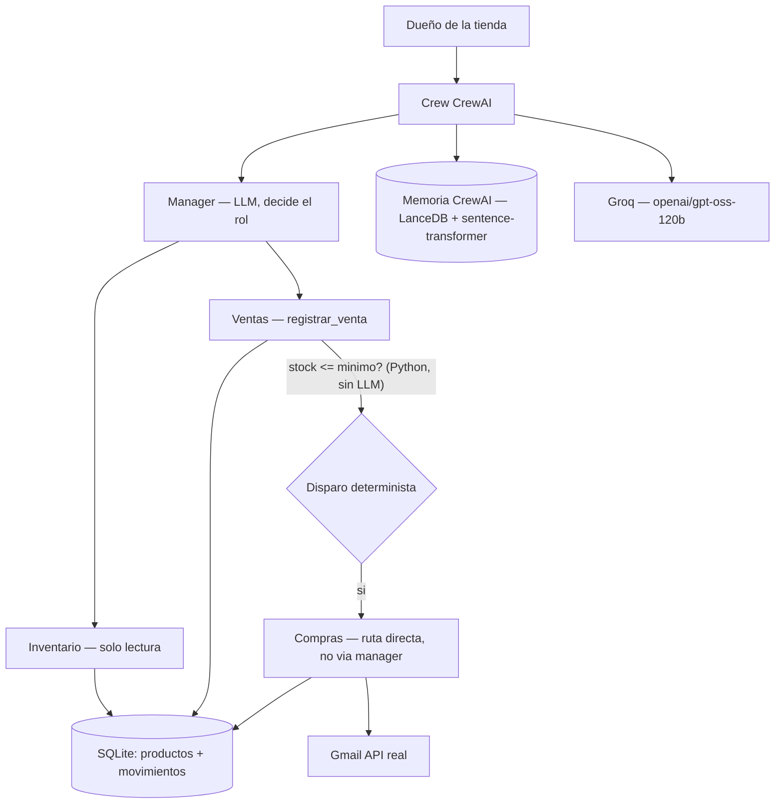

# Gestión de Tienda IA

Agentes sobre stock de una tienda genérica (productos, movimientos,
proveedores). No es específico de un rubro: sirve para ferretería, almacén,
librería, etc.

EP2 ISY0101, Duoc UC. Evolución conceptual de `asistente-pedidos360` (EP1),
sin la infraestructura AWS que ese proyecto necesitaba.

## Qué hace

Tres agentes con roles acotados (nadie tiene más herramientas de las que
necesita), coordinados por un manager, sobre una base de stock real en
SQLite:

- **Inventario** — solo lectura: consulta stock, productos bajo mínimo,
  historial de movimientos de un producto.
- **Ventas** — registra ventas. Si una venta deja el stock en o bajo el
  mínimo, **dispara sola** la reposición (planificación adaptativa, ver
  `ESQUEMA-PLANIFICACION.md`).
- **Compras** — el único rol con acceso a Gmail. Redacta y envía órdenes
  de reposición reales a proveedores.

## Setup

```bash
uv sync
uv run python autenticar_gmail.py   # una vez, abre el navegador para el login de Gmail
uv run python db.py                 # crea tienda.db con datos de demo
cp .env.example .env                # completar GROQ_API_KEY
```

`credentials.json`, `gmail_token.json`, `.env` y `tienda.db` no se versionan
(`.gitignore`) — son credenciales o datos de runtime, no código fuente.

### Correr

```bash
uv run python agentes.py            # demo: una venta de ejemplo
uv run pytest test_stock.py -v      # 10 tests de la capa determinista
uv run python medir.py              # medicion de tokens/latencia (3 casos)
```

## 1. Decisión de runtime (ADR)

**Contexto:** hay que orquestar un LLM, herramientas, memoria y tres roles
con objetivos distintos (consultar stock, vender, negociar con un
proveedor).

**Camino "actual" del curso:** LangGraph (`RA2/IL2.4/0-arquitectura-ra2.md`).

**Decisión de este proyecto: CrewAI.**

**Justificación:** los tres roles tienen prompts de sistema
*incompatibles* entre sí — "atiendes al cliente, no contactas
proveedores" (Ventas) choca directamente con "rediactas órdenes y las
envías" (Compras). Ese es exactamente el criterio que la plantilla del
curso reserva para CrewAI ("Prompts de sistema incompatibles + proceso"),
no para un grafo de LangGraph con un único system prompt por nodo.

**Alternativas rechazadas:**

- **`create_agent` + checkpointer (LangGraph)**: resuelve bien memoria +
  un rol, pero tres roles con prompts incompatibles exigirían simular
  "sub-agentes" a mano dentro del mismo grafo — reinventar lo que CrewAI
  ya da con `Agent` + `role`/`backstory`.
- **`AgentExecutor`**: la propia plantilla del curso lo marca como "leer,
  no empezar".
- **Python puro sin LLM para todo**: se usó donde correspondía (ver
  "capa determinista" abajo) pero no alcanza para razonar sobre lenguaje
  natural del dueño de la tienda ni para redactar un correo a un
  proveedor.

**Costo medido de la elección:** `MEDICION.md` — el manager jerárquico +
memoria nativa de CrewAI cuestan 15 000–20 000 tokens y 60–80 segundos
por operación simple, dominado por llamadas de soporte (búsqueda de
memoria, consolidación), no por el trabajo visible. Es el precio real de
tener 3 roles independientes con memoria persistente en vez de un único
prompt.

## 2. Vista C4 (contexto)



Capas:

| Capa | En este proyecto |
|---|---|
| Presentación | script (`agentes.py`), sin UI todavía |
| Aplicación | `Crew` + `Agent` (CrewAI), `Process.hierarchical` |
| Dominio | `stock.py` — capa determinista, sin LLM, testeada (`test_stock.py`) |
| Infraestructura | Groq (LLM), Gmail API (correo real), SQLite (stock), LanceDB (memoria) |

El patrón clave: **el dominio (`stock.py`) no sabe que existe un LLM.** Es
Python puro, testeable sin red ni tokens. Los agentes son una capa encima
que *envuelve* esas funciones como tools — mismo principio que
`1-architecture_example.py` del curso: clasificar/decidir puede llevar
LLM, ejecutar la acción de negocio no.

## 3. Contratos

### Memoria (IE3/IE4)

- **Corto plazo** (`memory=True` nativo de CrewAI, `root_scope` derivado
  del nombre de la crew por `conversacion_id`): aísla lo que preguntó un
  cliente de lo que preguntó otro. Probado: un segundo turno recordó de
  qué producto se hablaba sin que se repitiera el nombre.
- **Largo plazo, semántica** (IE4): CrewAI persiste su memoria como
  vectores reales en disco (`~/.local/share/gestion-tienda-ia/memory/
  memories.lance`), con embeddings locales (`sentence-transformer`,
  `all-MiniLM-L6-v2` — Groq no ofrece endpoint de embeddings).
- **Largo plazo, de dominio**: la tabla `movimientos` en SQLite ya es
  persistente entre sesiones. No se montó un vector store para esto — la
  pregunta típica ("qué pasó con este producto") es una consulta
  estructurada por ID, no una búsqueda semántica de texto libre. Hacerlo
  con embeddings habría sido sobre-ingeniería.

### Herramientas

| Tool | Rol | Entrada válida | Entrada inválida / qué pasa |
|---|---|---|---|
| `consultar_stock` | Inventario | `"Taladro"` → coincidencia parcial | vacío `""` → devuelve todo |
| `productos_bajo_minimo` | Inventario, Ventas | sin argumentos reales | `filtro` es dummy (ver nota de guión bajo abajo) |
| `historial_producto` | Inventario | `producto_id` entero existente | ID inexistente → lista vacía, no error |
| `registrar_venta` | Ventas | `producto_id`, `cantidad` entera positiva | stock insuficiente → `ValueError` explícito, no vende parcial |
| `registrar_reposicion` | Compras | igual que arriba | producto inexistente → `ValueError` |
| `enviar_correo_a_proveedor` | Compras (único con Gmail) | destinatario, asunto, cuerpo | sin `gmail_token.json` → falla con instrucción de cómo generarlo |

**Nota de un bug real encontrado:** una tool sin parámetros reales hace
que Groq rechace el JSON Schema (`required` presente sin `properties`).
El primer intento de arreglo (parámetro `_sin_uso: str = ""`) no funcionó:
pydantic trata los nombres con guion bajo inicial como atributos
*privados* y los excluye del schema igual. Solución real: un parámetro
dummy sin guion bajo (`filtro: str = ""`).

### Tope de iteraciones / reintentos

CrewAI delega en litellm el retry ante `429` de Groq. Se midió en vivo
durante `medir.py`: cada corrida reintentó varias veces contra el límite
compartido de 8000 tokens/minuto (por modelo, toda la organización) sin
caerse — ver `MEDICION.md`.

### Identificación de hilo (memoria)

`conversacion_id` (parámetro de `crear_crew`) — análogo al `thread_id` de
LangGraph. Se "olvida" simplemente usando un `conversacion_id` nuevo; no
hay borrado explícito implementado (sería un `rm -rf` sobre la carpeta de
LanceDB del `root_scope` correspondiente).

## 4. Planificación y decisiones adaptativas (IE5/IE6)

Ver `ESQUEMA-PLANIFICACION.md` — diagrama de prioridades y tres
implementaciones reales de la misma tarea (enviar un correo) que
terminaron en comportamientos distintos:

1. Manager automático (`manager_llm`): delegó a Ventas en vez de Compras.
2. Manager con instrucciones explícitas: razonó correcto, pero no
   invocó la delegación — se quedó en el diagnóstico.
3. Ruta directa (`generar_orden_compra`, sin pasar por el manager): correo
   real enviado, confirmado con ID de Gmail.

Esa progresión (2 intentos fallidos documentados, no ocultados) es la
base de la decisión arquitectónica: **una acción con efecto real en el
mundo no puede depender de que el LLM decida ejecutarla.**

## 5. Medición (IE9)

Tabla completa en `MEDICION.md`. Resumen: 3 casos representativos,
57–82 segundos, 15 000–20 000 tokens cada uno contra `openai/gpt-oss-120b`.
Hallazgo contraintuitivo (documentado, no escondido): la tarea más
compleja (venta + reposición + correo) usó *menos* tokens que una venta
simple, porque el costo real está dominado por las llamadas internas de
memoria de CrewAI, no por el trabajo visible del agente.

## 6. Referencias

- CrewAI — <https://docs.crewai.com/>
- Groq API (modelos `openai/gpt-oss-120b`, `openai/gpt-oss-20b`) —
  <https://console.groq.com/docs/models>
- Gmail API (Python, OAuth de escritorio) —
  <https://developers.google.com/gmail/api/guides>
- sentence-transformers (embeddings locales) —
  <https://www.sbert.net/>
- LanceDB (vector store usado por CrewAI para memoria) —
  <https://lancedb.github.io/lancedb/>
